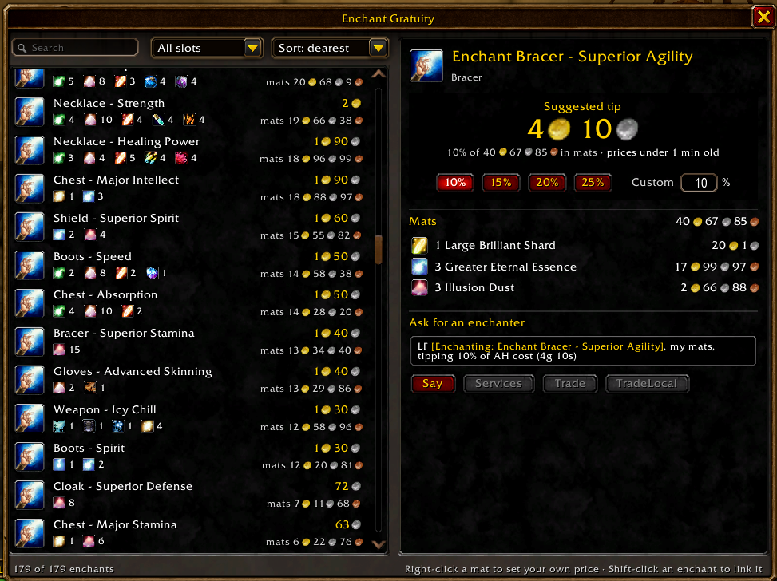
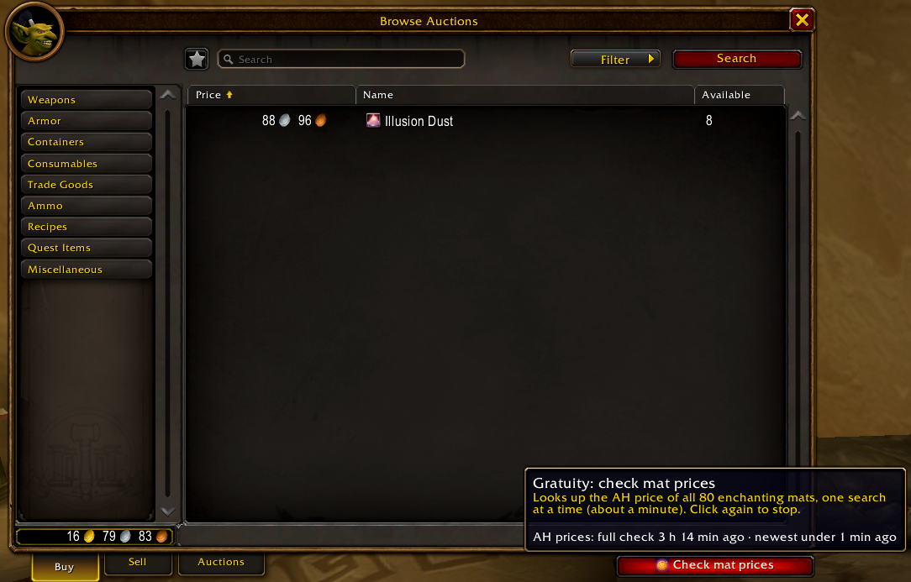
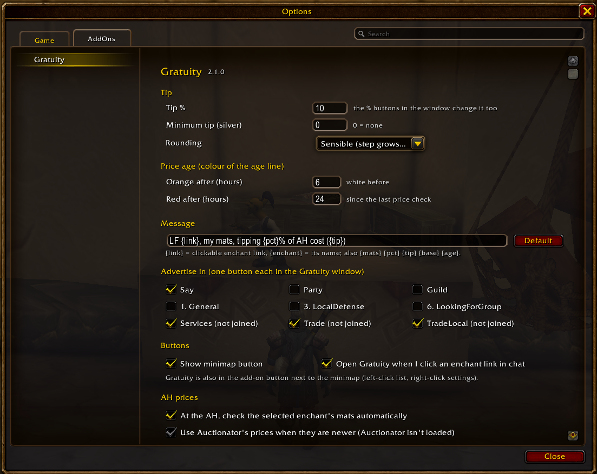

# Gratuity

**What does an enchant cost in mats, and what's a fair tip for the enchanter?** Gratuity answers both for the enchant you want,
and writes the "LF enchanter" message for you.

Made for **World of Warcraft: Forever**, for players who *buy* enchants: you bring the mats, the enchanter brings the recipe,
and you tip them for it.

## What it does

- **All enchants in one window.** Search by enchant, slot or mat name, filter by slot, sort by slot, name, cheapest or dearest.
  Each row shows the suggested tip and the mats cost.
- **Mats and their prices.** The selected enchant shows each mat with its price, where the price came from and how old it is,
  how many you have, and what you **still need to buy**. Hover a mat for details; right-click it to set your own price.
- **A tip you can stand behind.** A % of the mats cost: 10 / 15 / 20 / 25 % buttons or any custom %; the last one you picked is
  remembered. Rounded sensibly (whole gold for big tips, copper for tiny ones), with an optional minimum tip.
- **Ready-made message.** "LF [Enchanting: Enchant Boots - Minor Stamina], my mats, tipping 10% of AH cost (8c)", with the
  enchant as a clickable link. Edit the template in the settings. One button per channel (TradeLocal by default; Say, Party, Guild or any joined channel) opens the chat box with the
  message: you check it and press Enter. Gratuity never sends anything by itself.
- **Its own AH prices, no other add-on needed.** At the AH, Gratuity checks the selected enchant's mats by itself, one search at a
  time and only while the AH is free. The **Check mat prices** button under the AH window checks all mats in about a minute.
  Prices are also picked up from your own AH searches and from merchants that sell a mat.
- **Works with Auctionator** (optional): its scan prices are used when they are newer, and *Search AH* opens the mats you still
  need in its Shopping tab. Without Auctionator, *Search AH* puts the first mat in the AH search box.
- **Click an enchant link in chat** (an enchanter's `[Enchanting: ...]` post) and Gratuity opens on that enchant.
- Minimap button and add-on compartment entry: left-click for the window, right-click for the settings.

## Screenshots

**Check mat prices** under the AH window looks up every enchanting mat:

Settings in Options > AddOns > Gratuity:

## Commands

| Command | What it does |
|---|---|
| `/gratuity` | open or close the window |
| `/gratuity prices` | at the AH: check all mat prices (again to stop); same as the button under the AH window |
| `/gratuity options` | settings |
| `/gratuity dump <enchant>` | mats, prices, tip and message in chat (e.g. `/gratuity dump boots minor stamina`) |
| `/gratuity age` | how old the AH prices are |
| `/gratuity tip <percent>` | set the tip % |
| `/gratuity check` | compare the shipped enchant list with the game's (after a patch) |
| `/gratuity minimap` | show or hide the minimap button |
| `/gratuity help` | list the commands |

## Good to know

- Prices are only as fresh as the last check; Gratuity always shows how old they are (orange and red when old, adjustable).
- The enchant list (179 enchants, 44 of them new in Forever) comes from the game's own data; names, icons and mats are read
  from the game while you play, so a patch that changes a recipe shows up at once.
- Bundled libraries: LibStub, CallbackHandler-1.0, LibDataBroker-1.1, LibDBIcon-1.0 (licences in `Libs/LICENSES.txt`).

## Transparency
This add-on was made with [Claude Code](https://claude.com/claude-code), Anthropic's AI coding assistant. Claude worked out
how the Forever client lists enchants, reads recipes and answers auction house searches (designing the in-game tests that
showed it), generated the enchant list from the game's own data, and wrote the code, documentation and icon; I decided what
the add-on should do and how it should look, reviewed the changes, and tested each version in game.

Made for World of Warcraft: Forever 1.60.1 (Interface 16001).

Licence: MIT (see `LICENSE`). Changes: see `CHANGELOG.md`.
